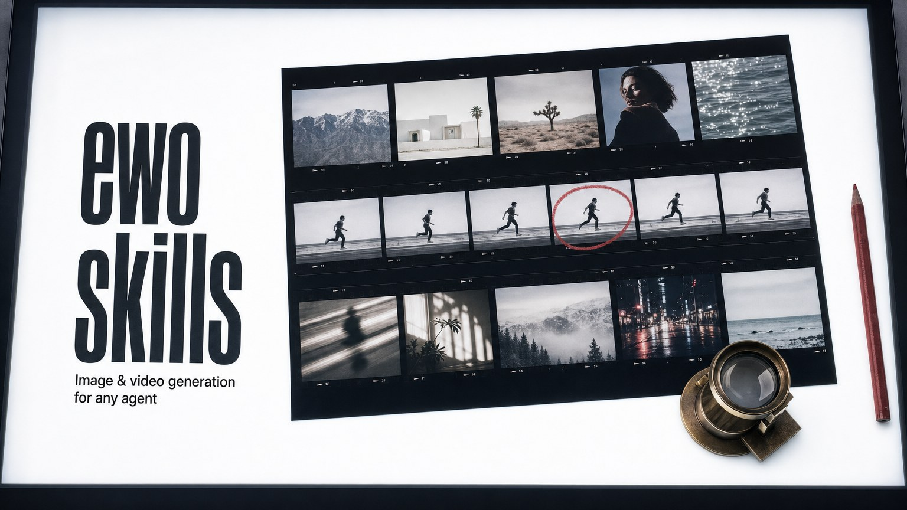

# ewo-skills

对 Agent 说一句话就能画图、改图、生成视频，成品存到本地；按量从 ewo 钱包扣费，不订阅。

<p align="center">
  
</p>

## 实际效果

上面的头图就是用 ewo 的 `gpt-image-2` 画的：提交一段提示词，出一张图，只裁成 16:9 并压缩，没有修图（2026-10-20）。

<details>
<summary>头图的提示词原文（英文）</summary>

```text
Create a wide GitHub README banner for an open-source project named "ewo skills": agent skills that turn a text prompt into images and videos. Visual world: a photo editor's light table seen from above. A black-bordered contact sheet with rows of small frames, a few still photographs and a few consecutive film frames showing motion; one frame circled in red grease pencil; a brass loupe resting on the sheet. Style: bright cool light-table white, black film borders, a single red grease-pencil accent. The title "ewo skills" is written in a bold condensed black sans-serif along the left edge of the light table, with the small subtitle "Image & video generation for any agent". Keep every key element inside the central horizontal band so the image can be cropped to 16:9. Restrained: one main subject, generous negative space. No logos, no watermark, no other readable text.
```

</details>

这是 ewo 图像能力的一次真实出图，不是 Agent 会话的截图，也不是按本仓库 `SKILL.md` 的流程出的图。〔待补：用 `ewo-image-generate` 画图、改图的真实输出，每张图旁写明提示词和模型；`ewo-video-generate` 的视频示例（首帧或 GIF）〕

## 状态与限制

- **能用在哪**：`SKILL.md` 按 Agent Skills 格式写成，原则上任何加载该格式的 Agent 都能用。**已实测宿主：〔待补〕**，在具体 Agent 里自动加载并完成一次生成的验证还没做。
- **依赖**：`curl` 和 POSIX shell（macOS、Linux、Windows 的 Git Bash）；PowerShell 里要改用 `curl.exe` 并改写循环；一个 ewo API key。没有 Node、Python 依赖。
- **费用**：按量从预付 ewo 钱包扣，无订阅；图片生成失败不扣费，视频失败退回预扣额度；`SKILL.md` 称新账号有试用额度，额度多少〔待核〕。
- **数据去向**：技能读 `EWO_API_KEY` 或 `~/.ewo/api_key`；你的提示词和提供的图片发往 `https://api.ewo.so`，ewo 保留多久〔待核〕；成品存到当前目录，请求和任务 JSON 写在 `/tmp/ewo-*.json`。
- **维护**：由 ewo 维护，`SKILL.md` 随 ewo 的能力清单更新；许可证 MIT。

## 安装（三步）

前置条件：能运行 `curl` 的 shell，以及一个 ewo API key（第 2 步拿）。

### 1. 装技能

推荐：把这句话发给你的 Agent，它会按 [`docs/install.md`](./docs/install.md) 装好。

```text
帮我安装 ewo-skills 里的图像和视频生成技能：https://raw.githubusercontent.com/RZX00/ewo-skills/main/docs/install.md
```

手动安装：把 `SKILL.md` 下载到 Agent 的技能目录。下面以 Claude Code 的 `~/.claude/skills/` 为例，其他 Agent 换成各自的目录。

```bash
# 图像：生成与编辑
curl -fsSL https://raw.githubusercontent.com/RZX00/ewo-skills/main/ewo-image-generate/SKILL.md --create-dirs -o ~/.claude/skills/ewo-image-generate/SKILL.md
# 视频：文生视频、图生视频
curl -fsSL https://raw.githubusercontent.com/RZX00/ewo-skills/main/ewo-video-generate/SKILL.md --create-dirs -o ~/.claude/skills/ewo-video-generate/SKILL.md
```

### 2. 配 ewo key（只需一次）

1. 在 https://api.ewo.so/sign-up 注册。
2. 在 https://api.ewo.so/keys 创建 key，以 `sk-eapi-` 开头（旧的 `sk-ewo-` 也能用）。
3. 把 key 单独一行写进 `~/.ewo/api_key`，或在 shell 里 `export EWO_API_KEY=sk-eapi-...`。

装了 ewo 桌面端的电脑上，`~/.ewo/credentials` 是桌面端自己的目录，不要往里写 key。额度用完了，在 https://api.ewo.so/console/topup 充值。

### 3. 对 Agent 说一句话

见下一节「第一次使用」。

## 第一次使用

key 配好后，对 Agent 说，注意点名技能：

```text
用 ewo-image-generate 画一只水彩风格的橘猫
```

你会得到：当前目录下的 `ewo-image-<时间戳>.<扩展名>`（通常是 png），Agent 会告诉你保存路径。一张图约需 30 秒到几分钟。

再试三句：

```text
用 ewo-image-generate 把 ewo-image-<时间戳>.png 的背景换成海边
用 ewo-video-generate 生成一段霓虹东京雨夜的 5 秒短视频
用 ewo-video-generate 让这张图动起来，做成 5 秒视频：ewo-image-<时间戳>.png
```

5 秒的视频通常要 1 到 5 分钟。视频接口默认 1080p，是最贵的一档；只想看看效果时，明说「用 720p」或「用 480p」。

## 和自己调 API 比，差在哪

| 要做的事 | 自己写脚本调 API | 装了这两个技能 |
|---|---|---|
| 提交并等结果 | 图片要提交异步任务再轮询，视频要提交后轮询到完成，再下载 | Agent 按 `SKILL.md` 做完这几步，告诉你保存路径 |
| 选模型 | 自己查文档 | 默认 `gpt-image-2`、`wan3.0-video`；你点名别的模型时，Agent 先列出你的 key 当前能用的模型再选 |
| 出错 | 自己判断哪类错误能重试 | 技能写明 401、402、400、429、503/524 各怎么办，余额不足（402）不重试 |
| 没有 key | 调用失败 | 技能规定没有 key 时不调用 API，先带你注册和建 key |

## 两个技能

| | `ewo-image-generate` | `ewo-video-generate` |
|---|---|---|
| 做什么 | 文生图；用一张或多张参考图改图；`gpt-image-2` 可用蒙版只改局部 | 文生视频；图生视频（首帧，可加尾帧）；用参考图、视频、音频生成 |
| 默认模型 | `gpt-image-2` | `wan3.0-video` |
| 接口 | `POST /v1/images/generations`、`POST /v1/images/edits`，轮询 `GET /v1/image-jobs/<id>` | `POST /v1/videos/generations`，轮询 `GET /v1/videos/generations/<id>` |
| 计费 | 按张；失败不扣 | 按秒、按分辨率；提交时先扣预估上限，完成后退差额，失败全退 |
| 常用参数 | `size`：`1024x1024`、`1536x1024`、`2048x1152`（2K）、`3840x2160`（4K）；`output_format`：`png`、`jpeg`、`webp` | `resolution`：`480p`、`720p`、`1080p`（默认，最贵）；`duration`：2 到 30 秒，默认 5；`aspect_ratio` |

接口地址都在 `https://api.ewo.so` 下。图片渲染可能比 API 边缘保持连接的时间还长，所以技能一律提交异步任务再轮询。Gemini 系列图像模型不管 `size` 写多少，都约按 1K 出图；要 2K 或 4K 用 `gpt-image-2`。视频的下载链接至少有效一天，任务保留 7 天。完整参数见两个 [`SKILL.md`](./ewo-image-generate/SKILL.md)。

## 出错时怎么办

| 状态码 | 含义 | 技能的做法 |
|---|---|---|
| 401 | key 缺失、无效或过期 | 带你重走注册和建 key，然后停下 |
| 402 `HABITAT_INSUFFICIENT_BALANCE` | 钱包余额不足 | 请你到 https://api.ewo.so/console/topup 充值，不重试 |
| 400 | 请求有误；未知模型也可能是 400 或 404 | 按 `error.message` 改请求，或换成列出的模型 |
| 429 | 限流 | 等 `Retry-After` 秒后重试一次 |
| 503、524 | 临时容量不足或边缘超时 | 等几秒重试一次 |

任务状态为 `failed`、`cancelled`、`expired` 时，图片不扣费，视频的预扣额度退回。

## 仓库内容

```text
ewo-image-generate/SKILL.md   图像技能
ewo-video-generate/SKILL.md   视频技能
docs/install.md               给 Agent 读的安装说明
docs/assets/                  头图和效果图
LICENSE                       MIT
```

## 贡献与许可证

两个 `SKILL.md` 由 ewo 的能力清单生成，直接改会在下次生成时被覆盖；想改动请提 [issue](https://github.com/RZX00/ewo-skills/issues)。

MIT，详见 [`LICENSE`](./LICENSE)。
